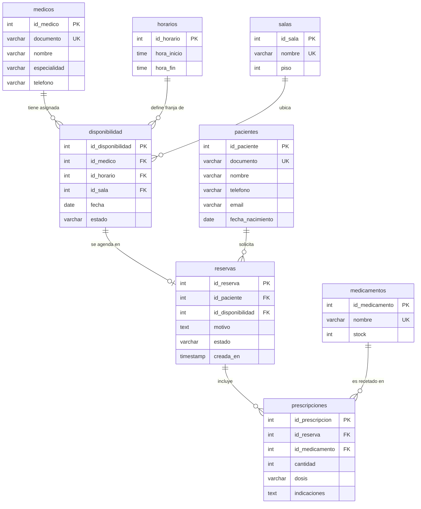

# MediCitas - Diseño y Arquitectura de Persistencia Políglota

Este documento detalla la arquitectura de persistencia del sistema de gestión hospitalaria **MediCitas**, diseñado para funcionar de manera intercambiable con dos paradigmas de almacenamiento de datos: **Relacional (PostgreSQL)** y **No Relacional (Cloud Firestore)**, garantizando la misma interfaz, validaciones de negocio y transacciones ACID en ambos entornos.

---

## 1. Diagrama Entidad-Relación Relacional (PostgreSQL)



---

## 2. Diccionario de Datos Relacional (PostgreSQL)

### 2.1 Tabla `medicos`
| Campo | Tipo | Restricciones | Descripción |
|---|---|---|---|
| `id_medico` | SERIAL | PRIMARY KEY | Identificador numérico único autoincremental del médico. |
| `documento` | VARCHAR(20) | UNIQUE, NOT NULL | Cédula de ciudadanía o tarjeta profesional del médico. |
| `nombre` | VARCHAR(120) | NOT NULL | Nombre y apellidos del profesional de la salud. |
| `especialidad` | VARCHAR(80) | NOT NULL | Rama de la medicina (Cardiología, Pediatría, etc.). |
| `telefono` | VARCHAR(20) | NULL | Número de contacto telefónico del médico. |

### 2.2 Tabla `horarios`
| Campo | Tipo | Restricciones | Descripción |
|---|---|---|---|
| `id_horario` | SERIAL | PRIMARY KEY | Identificador único de la franja horaria. |
| `hora_inicio` | TIME | NOT NULL | Hora militar de inicio de la consulta (ej. 08:00:00). |
| `hora_fin` | TIME | NOT NULL, CHECK(hora_fin > hora_inicio) | Hora militar de culminación de la consulta (ej. 09:00:00). |

### 2.3 Tabla `salas`
| Campo | Tipo | Restricciones | Descripción |
|---|---|---|---|
| `id_sala` | SERIAL | PRIMARY KEY | Identificador único de la sala o consultorio. |
| `nombre` | VARCHAR(60) | UNIQUE, NOT NULL | Nombre distintivo del consultorio (ej. Consultorio 101). |
| `piso` | INT | NOT NULL, CHECK(piso > 0) | Número del piso físico donde se ubica la sala. |

### 2.4 Tabla `pacientes`
| Campo | Tipo | Restricciones | Descripción |
|---|---|---|---|
| `id_paciente` | SERIAL | PRIMARY KEY | Identificador numérico único del paciente. |
| `documento` | VARCHAR(20) | UNIQUE, NOT NULL | Cédula o documento de identidad oficial. |
| `nombre` | VARCHAR(120) | NOT NULL | Nombre completo del paciente. |
| `telefono` | VARCHAR(20) | NULL | Teléfono móvil o de residencia. |
| `email` | VARCHAR(120) | NULL | Correo electrónico para notificaciones. |
| `fecha_nacimiento` | DATE | NULL | Fecha de nacimiento para cálculo de edad clínica. |

### 2.5 Tabla `disponibilidad`
| Campo | Tipo | Restricciones | Descripción |
|---|---|---|---|
| `id_disponibilidad` | SERIAL | PRIMARY KEY | Identificador único del cupo de atención médica. |
| `id_medico` | INT | NOT NULL, FK -> medicos(id_medico) ON DELETE RESTRICT | Médico al que pertenece el cupo. |
| `id_horario` | INT | NOT NULL, FK -> horarios(id_horario) ON DELETE RESTRICT | Franja horaria asignada. |
| `id_sala` | INT | NOT NULL, FK -> salas(id_sala) ON DELETE RESTRICT | Consultorio físico asignado. |
| `fecha` | DATE | NOT NULL | Fecha calendario de la atención (YYYY-MM-DD). |
| `estado` | VARCHAR(10) | NOT NULL, DEFAULT 'libre', CHECK(estado IN ('libre','ocupada')) | Disponibilidad del cupo. |
| *Índices únicos* | UNIQUE | (id_medico, id_horario, fecha), (id_sala, id_horario, fecha) | Garantiza que un médico o sala no se dupliquen en la misma hora y fecha. |

### 2.6 Tabla `reservas` (con vista alias `reserva`)
| Campo | Tipo | Restricciones | Descripción |
|---|---|---|---|
| `id_reserva` | SERIAL | PRIMARY KEY | Identificador único de la cita médica. |
| `id_paciente` | INT | NOT NULL, FK -> pacientes(id_paciente) ON DELETE RESTRICT | Paciente que asiste a la cita. |
| `id_disponibilidad` | INT | NOT NULL, FK -> disponibilidad(id_disponibilidad) ON DELETE RESTRICT | Cupo de horario tomado. |
| `motivo` | TEXT | NOT NULL | Síntomas, motivo de consulta o requerimiento médico. |
| `estado` | VARCHAR(12) | NOT NULL, DEFAULT 'programada', CHECK(estado IN ('programada','atendida','cancelada')) | Estado actual del ciclo de vida de la cita. |
| `creada_en` | TIMESTAMP | DEFAULT NOW() | Marca temporal de creación del registro. |
| *Índice parcial* | UNIQUE | (id_disponibilidad) WHERE estado <> 'cancelada' | Asegura que un cupo no tenga dos reservas simultáneas activas. |

### 2.7 Tabla `medicamentos`
| Campo | Tipo | Restricciones | Descripción |
|---|---|---|---|
| `id_medicamento` | SERIAL | PRIMARY KEY | Identificador único del producto farmacéutico. |
| `nombre` | VARCHAR(120) | UNIQUE, NOT NULL | Nombre comercial y concentración (ej. Ibuprofeno 400mg). |
| `stock` | INT | NOT NULL, DEFAULT 0, CHECK(stock >= 0) | Unidades físicas disponibles en el inventario. |

### 2.8 Tabla `prescripciones`
| Campo | Tipo | Restricciones | Descripción |
|---|---|---|---|
| `id_prescripcion` | SERIAL | PRIMARY KEY | Identificador de la receta médica. |
| `id_reserva` | INT | NOT NULL, FK -> reservas(id_reserva) ON DELETE CASCADE | Cita médica donde fue emitida la receta. |
| `id_medicamento` | INT | NOT NULL, FK -> medicamentos(id_medicamento) ON DELETE RESTRICT | Medicamento prescrito. |
| `cantidad` | INT | NOT NULL, CHECK(cantidad > 0) | Unidades a entregar al paciente. |
| `dosis` | VARCHAR(120) | NULL | Pauta posológica (ej: 1 cada 8 horas). |
| `indicaciones` | TEXT | NULL | Recomendaciones adicionales de administración médica. |

---

## 3. Estructura de Colecciones Cloud Firestore (No Relacional)

En Cloud Firestore, el modelo se diseñó de forma **desnormalizada** para optimizar lecturas masivas y evitar costosas consultas multitabla que no existen de forma nativa en motores NoSQL documentales.

### 3.1 Colección `medicos/{id}`
```json
{
  "documento": "71234567",
  "nombre": "Dr. Carlos Andrés Mejía Restrepo",
  "especialidad": "Cardiología",
  "telefono": "3101234567"
}
```

### 3.2 Colección `pacientes/{id}`
```json
{
  "documento": "1012345678",
  "nombre": "Andrés Felipe Torres Mosquera",
  "telefono": "3101111111",
  "email": "andres.torres@email.com",
  "fechaNacimiento": "1990-03-15"
}
```

### 3.3 Colección `salas/{id}`
```json
{
  "nombre": "Consultorio 101",
  "piso": 1
}
```

### 3.4 Colección `horarios/{id}`
```json
{
  "horaInicio": "08:00",
  "horaFin": "09:00"
}
```

### 3.5 Colección `medicamentos/{id}`
```json
{
  "nombre": "Ibuprofeno 400mg",
  "stock": 148
}
```

### 3.6 Colección `disponibilidad/{id}` (Desnormalizada)
Almacena copias de los nombres del médico, especialidad, consultorio y franja horaria para permitir consultas y filtrados directos sin requerir `JOIN`:
```json
{
  "medicoId": "m_carlos_mejia",
  "medicoNombre": "Dr. Carlos Andrés Mejía Restrepo",
  "especialidad": "Cardiología",
  "salaId": "s_101",
  "salaNombre": "Consultorio 101",
  "piso": 1,
  "horarioId": "h_08_09",
  "horaInicio": "08:00",
  "horaFin": "09:00",
  "fecha": "2026-11-16",
  "estado": "libre"
}
```

### 3.7 Colección `reservas/{id}` (Desnormalizada con Subcolección)
Contiene la información del paciente, médico, horario y sala en el mismo documento:
```json
{
  "pacienteId": "p_andres_torres",
  "pacienteNombre": "Andrés Felipe Torres Mosquera",
  "pacienteDocumento": "1012345678",
  "disponibilidadId": "d_20261116_0800",
  "medicoId": "m_carlos_mejia",
  "medicoNombre": "Dr. Carlos Andrés Mejía Restrepo",
  "especialidad": "Cardiología",
  "salaNombre": "Consultorio 101",
  "fecha": "2026-11-16",
  "horaInicio": "08:00",
  "horaFin": "09:00",
  "motivo": "Dolor de pecho y palpitaciones tras esfuerzo físico",
  "estado": "programada",
  "creadaEn": "2026-11-13T04:10:00.000Z"
}
```

#### Subcolección: `reservas/{id}/prescripciones/{prescripcionId}`
Permite el aislamiento transaccional de los medicamentos recetados a la cita:
```json
{
  "medicamentoId": "med_losartan",
  "medicamentoNombre": "Losartán 50mg",
  "cantidad": 30,
  "dosis": "1 tableta cada 24 horas",
  "indicaciones": "Tomar en ayunas con abundante agua"
}
```

---

## 4. Justificación del Diseño y Desnormalización en NoSQL

1. **Ausencia de operaciones `JOIN` en Firestore**:
   En bases de datos NoSQL basadas en documentos, no existe la operación `JOIN`. Para mostrar una tabla de citas en una base puramente normalizada, el backend tendría que realizar múltiples consultas individuales por cada fila (problema $N+1$). Al desnormalizar atributos descriptivos (`pacienteNombre`, `medicoNombre`, `especialidad`, `salaNombre`, `horaInicio`), una sola lectura de colección entrega la vista completa.

2. **Optimización de lectura frente a escritura**:
   En un sistema hospitalario, las consultas de citas y cupos libres son entre 10 y 20 veces más frecuentes que las modificaciones de nombres de médicos o salas. La desnormalización favorece la latencia de lectura ultrarrápida.

3. **Prevención de Índices Compuestos Obligatorios**:
   Firestore exige índices compuestos pregenerados en la consola de Firebase cuando se combinan múltiples cláusulas `.where()` de diferente campo con operadores de rango o desigualdad. Para evitar fallas en despliegues automatizados (como Render), el repositorio Firestore utiliza filtros atómicos simples en base de datos y resuelve filtrados adicionales en memoria.

4. **Consistencia Transaccional con `firestore.runTransaction()`**:
   Las operaciones críticas de negocio (agendar cita, cancelar, reprogramar, descontar y devolver stock de medicamentos) se ejecutan dentro de bloques de transacción de Firestore, asegurando aislamiento Serializable idéntico a `SELECT ... FOR UPDATE` en PostgreSQL.

---

## 5. Tabla Comparativa: PostgreSQL vs Cloud Firestore

| Dimensión | PostgreSQL (Relacional) | Cloud Firestore (NoSQL Documental) |
|---|---|---|
| **Modelo de Datos** | Tablas tabulares normalizadas con esquema estricto (3FN) y tipos de datos fuertes (`TIME`, `DATE`, `SERIAL`). | Colecciones de documentos JSON semiestructurados y subcolecciones anidadas. |
| **Relaciones** | Claves foráneas formales (`FOREIGN KEY`) con validación y cascada gobernada por el motor de base de datos (`ON DELETE RESTRICT / CASCADE`). | Referencias mediante identificadores de documento en texto y datos desnormalizados. La integridad se gestiona a nivel de código de aplicación. |
| **Integridad Referencial** | Nativa e inviolable en el motor. Restringe eliminaciones huérfanas mediante constraints de base de datos. | Lógica de negocio en repositorios que inspecciona colecciones dependientes antes de ejecutar eliminaciones. |
| **Transacciones** | Transacciones ACID completas con control de concurrencia mediante `BEGIN`, `COMMIT`, `ROLLBACK` y bloqueos de fila (`FOR UPDATE`). | Transacciones optimistas atómicas con reintentos automáticos mediante `runTransaction` y lotes de escritura (`writeBatch`). |
| **Consultas Complejas** | Gran potencia mediante SQL estándar: `JOIN`, `GROUP BY`, `COUNT`, índices parciales condicionales y filtros arbitrarios. | Consultas optimizadas para búsquedas por clave o igualdad única. Agregaciones complejas requieren cálculo en memoria o contadores distribuidos. |
| **Escalabilidad** | Escalabilidad vertical tradicional (CPU/RAM). Para alta concurrencia requiere réplicas de lectura y connection pooling. | Escalabilidad horizontal automática nativa en la nube de Google, gestionando picos masivos de tráfico sin configuración manual. |
| **Consistencia** | Consistencia inmediata fuerte (ACID). Todos los clientes observan inmediatamente los datos confirmados. | Consistencia fuerte en lecturas y escrituras de documentos individuales y transacciones; consistencia eventual en índices globales. |
| **Esquema e Índices** | Esquema rígido definido por DDL (`schema.sql`). Creación explícita de índices (`B-Tree`, índices parciales). | Esquema flexible sin DDL previo. Indexación automática de campos individuales; los índices compuestos requieren definición previa. |
| **Costo Operativo** | Costo predecible basado en cómputo/instancia de servidor provisionada (fija al mes). | Modelo *Serverless* de pago por uso (número de operaciones de lectura, escritura y almacenamiento consumido). |
| **Cuándo usar en este proyecto** | Ideal para administración central hospitalaria con auditoría rigurosa, facturación médica, control de inventario farmacéutico estricto e integridad referencial inviolable. | Ideal para aplicaciones móviles de pacientes en tiempo real, portales de telemedicina con alta concurrencia geográfica y despliegues sin servidor. |

---

## 6. Implementación del Patrón Repository

El sistema aplica el **Repository Pattern** como capa de abstracción entre los servicios de negocio y la base de datos física:

```
[Controladores Express]
          │
          ▼
   [Servicios de Negocio]
          │
          ▼
[Fábrica de Repositorios (src/repositories/index.js)]
     │                                     │
     ├─ (DB_ENGINE='postgres')             ├─ (DB_ENGINE='firestore')
     ▼                                     ▼
[src/repositories/postgres/]          [src/repositories/firestore/]
  - medicos.repo.js                     - medicos.repo.js
  - disponibilidad.repo.js              - disponibilidad.repo.js
  - reservas.repo.js                    - reservas.repo.js
  - medicamentos.repo.js                - medicamentos.repo.js
```

Ambas implementaciones retornan la misma estructura JSON estandarizada con identificadores en formato `string` (ej: `{ id: "1" }` o `{ id: "kZb9s7A1q" }`) y campos en `camelCase`, permitiendo que el Frontend y los controladores operen de forma agnóstica al motor en ejecución.
